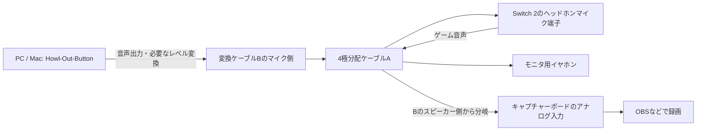

# Howl-Out-Button（わんコマンドボタン）

Nintendo Switch 2で『ピクミン4』の音声コマンドを使う構成を想定した、PC向けの音声再生アプリです。外付けのUSBキーやホットキーを押すと、登録した音声をPCの選択した音声出力から再生します。

PCの音声をケーブルで外部マイク入力へ送る方式を想定しており、アプリ自体がSwitch 2やゲームと通信するものではありません。任天堂・ITPROTECHの公式製品ではありません。ゲーム側の対応機能、配線、機器の組み合わせは使用環境で確認してください。

## できること

- 音源のドラッグ＆ドロップによる追加・コピー保存・削除
- 保存したホットキー1種類で、選択中の音源を再生
- USBマクロキー／ペダルなど、キーボード入力を送る機器の利用
- ピッチと再生速度の独立変更
- 押下回数の表示・リセット・非表示（表示への復帰も可能）

## ダウンロード

[リリース v0.2.0](https://github.com/koppacha/howl-out-button/releases/tag/v0.2.0)から、使用するOS・CPU向けのZIPをダウンロードしてください。

| 環境 | ダウンロード |
| --- | --- |
| Windows（x64） | [Howl-Out-Button-Windows-x64.zip](https://github.com/koppacha/howl-out-button/releases/download/v0.2.0/Howl-Out-Button-Windows-x64.zip) |
| macOS（Apple Silicon / Mシリーズ） | [Howl-Out-Button-macOS-arm64.zip](https://github.com/koppacha/howl-out-button/releases/download/v0.2.0/Howl-Out-Button-macOS-arm64.zip) |
| macOS（Intel） | [Howl-Out-Button-macOS-x64.zip](https://github.com/koppacha/howl-out-button/releases/download/v0.2.0/Howl-Out-Button-macOS-x64.zip) |

ZIPを展開し、Windowsはフォルダ内の `.exe`、macOSは `.app` を起動します。Windowsは同梱ファイルを含むフォルダ全体を保持してください。macOS版はアドホック署名で、公証は含みません。macOSの入力監視などの許可は下記の手順を参照してください。

## ビルドと起動

Python **3.11〜3.13（64bit）** を用意し、リポジトリをcloneします。

```sh
git clone https://github.com/koppacha/howl-out-button.git
cd howl-out-button
```

cloneしたフォルダで、使用するOSのビルドコマンドを実行します。

```sh
# macOS
python3.13 build.py
```

```powershell
# Windows
py -3.13 build.py
```

バージョン: **0.2.0**。初回はネット接続が必要です。専用の `.venv` を作成し、依存関係の取得、回帰テスト、PyInstallerでのビルド、生成アプリの自己診断を行います。失敗時はビルド完了扱いにしません。

| OS | 起動するファイル |
| --- | --- |
| macOS | `dist/Howl-Out-Button.app` |
| Windows | `dist/Howl-Out-Button/Howl-Out-Button.exe` |

ビルド後はネット接続や別途Pythonのインストールなしで起動できます。Windows版は **Howl-Out-Buttonフォルダ全体** を移動・配布してください。インストーラーやDMGの生成は行いません。OS・CPUごとに、その環境でビルドしてください。

再ビルド前に起動中の旧版を終了します。依存関係を取得済みなら `python3.13 build.py --no-install` でオフライン再ビルドできます。正式なmacOS署名IDがある場合は `--codesign-identity '署名ID'` を指定できます。指定しないローカル版はアドホック署名で、公証は含みません。

ソースコードは [koppacha/howl-out-button](https://github.com/koppacha/howl-out-button) で公開しています。GitHub ActionsでもmacOS / Windows向けにビルドできます。

## アプリの使い方

1. WAV / MP3 / M4A / AAC / FLAC / OGG / AIFFをドロップするか、「音源を追加」を押します。
2. 音源一覧から再生するものを1つ選択します。元ファイルはアプリ用フォルダへコピーされます。
3. 「ホットキーを登録」を押し、使用するキーを押して「登録」で保存します。
4. 「音声出力」から送信先のオーディオ端子を選びます。「OSの既定出力に自動追従」も使えます。
5. 準備完了後にホットキーを押すか「再生」で試聴します。押し直すと先頭から再生し、「停止」で止まります。
6. 必要に応じてピッチ（±12半音）・速度（0.5〜2倍）を調整します。変更中は再生を止め、音源を処理し直します。

ホットキー欄は保存済みキー表示・登録・削除の3要素です。単一キーまたはキーの組み合わせを1件保存します。登録画面を開いている間は既存ホットキーを停止し、キャンセルすると設定を維持します。CとShift+Cは同じ単独英字キーとして使えます。未登録のCtrl/Cmd等を加えた操作では発火しません。

### 押下回数

- **リセット**：カウントを0に戻して保存します。
- **非表示**：数値を隠します。ボタンが「表示」に変わり、再度押すと数値を表示します。
- 非表示中もカウントします。表示設定は次回起動時も維持します。
- キーの長押しは1回です。離してから再度押すと加算します。
- 画面の再生ボタンもカウント対象です。音源未選択・出力停止中の有効な押下も数えます。
- 通常終了時と毎秒保存します。強制終了では直近約1秒分が未保存になる場合があります。

### macOSのホットキー権限

アプリ内はQt、アプリ外はOSのキーボード監視で受け付けます。前面ではグローバル側を抑止し、二重再生を防ぎます。

アプリ外で使うには「システム設定 → プライバシーとセキュリティ → 入力監視」で現在のHowl-Out-Buttonを許可して再起動してください。拒否されている場合は「アプリ内のみ有効」と表示します。詳細はキー表示にマウスを置いて確認できます。

ONでも更新前のアプリへの許可が残る場合があります。旧版を完全終了し、古い登録を削除して現在の `.app` を追加し直してください。改名前の「SoundTrigger」が残る場合もあります。ソース実行時はターミナル／Pythonへの許可が必要な場合があります。OSの拒否をアプリが回避することはありません。

## 接続機材と配線例

- Nintendo Switch 2と、利用する音声入力機能に対応したゲーム環境
- PCまたはMac、キーボード入力を送るUSBマクロキー
- 4極分配ケーブル（A）と、マイク／スピーカー側へ分岐する変換ケーブル（B）
- PC側出力と接続するケーブル、モニタ用イヤホン
- 録画する場合：アナログ音声入力対応キャプチャーボードと録画ソフト（例：OBS Studio）

### 使用機材の実例と価格

| 用途 | 製品 | 価格 |
| --- | --- | ---: |
| ケーブルA | FUJIPATU（富士パーツ）AD-648 L型4極分配ケーブル | 1,990円 |
| ケーブルB | YouZipper P-34G 3.5mm/3x2 to 3.5mm/4 ADAPTER | 580円 |
| 外付けボタン | ITPROTECH「ちょい足しキーボード 2キー」MK-02 | 1,590円 |

以下は接続の構成例です。端子形状が同じでも配線・信号方向・信号レベルが同じとは限りません。CTIA等の配線と、PC出力をマイク入力へ送るための適切なレベル変換を確認してください。単なる分配・変換ケーブルでは対応できない機器もあります。



### 本体・ゲーム側の設定例

本体のオーディオ設定で、音声の出力先と入力マイクを本体ヘッドホンマイク端子へ合わせ、マイクテストでPC音声が入るか確認します。項目名や対応機能は本体・ゲームのバージョンに従ってください。

ゲーム側で対応する設定がある場合の調整例：音声入力ON、雑音フィルター1〜2、音量ブースター50%程度、「トッシンして」100%、その他コマンドOFF。認識状況に合わせて調整する目安で、アプリの既定値や動作保証ではありません。

### 外付けボタンの例：ITPROTECH MK-02

[ITPROTECH「ちょい足しキーボード 2キー」MK-02](https://www.itprotech.jp/macro-keyboard/mk-02/)（1,590円）など、キーボード入力を本体に保存できる機器を想定しています。

1. メーカーの対応する環境・設定ソフトで使用キーを割り当てます。設定ソフトの対応OSはメーカーの案内を確認してください。
2. 単独キーで使う場合は、修飾キーを `Empty` 等の未指定にして、機器本体へ保存します。
3. アプリに保存するキーと機器から送るキーを一致させます。
4. 背面に取り付ける場合は、指の届く位置・握り心地・ケーブルの取り回しを仮止めで確認します。

MIDI、独自USB、シリアル、GPIOの直接入力には対応しません。外部機器とゲームを含む配線構成の実機検証は、アプリの自動テストとは別に必要です。

## 保存場所と制約

旧版との互換性のため、保存フォルダは従来名のままです。

- macOS: `~/Library/Application Support/SoundTrigger/`
- Windows: `%LOCALAPPDATA%\SoundTrigger\`

`settings.json` に設定と回数、`audio/` にコピー音源、`cache/` に音声変換キャッシュを保存します。アプリの削除・再ビルドだけではデータは消えません。

音源は120秒まで。初回の変換には時間がかかり、処理中の終了はワーカーの完了まで遅れる場合があります。DRM付き・破損ファイル・一部コーデックには非対応です。レイテンシ表示はデバイス報告値です。音源や設定を外部へ送信する機能はありません。

## 開発

```sh
python3.13 -m venv .venv
.venv/bin/python -m pip install -r requirements.txt
.venv/bin/python -m unittest discover -s tests -v
.venv/bin/python run.py
```

Windowsでは `.venv/bin/python` を `.venv\Scripts\python.exe` に置き換えます。`--diagnose REPORT.json` は合成音源による自己診断です。実際のキーボード監視や音声出力を開始しません。

このソースには会話履歴・エージェント向けナレッジ・個人の音源・実行時設定を含めません。ライセンスは [LICENSE](LICENSE)、依存コンポーネントについては [THIRD_PARTY.md](THIRD_PARTY.md) を参照してください。
